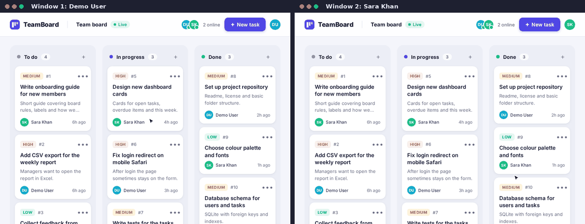
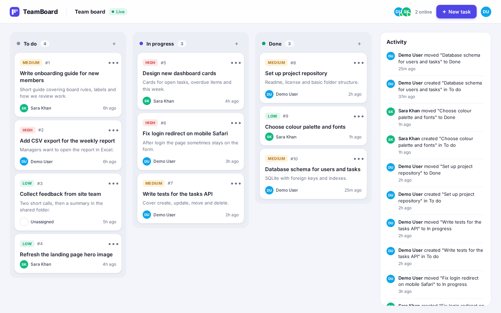
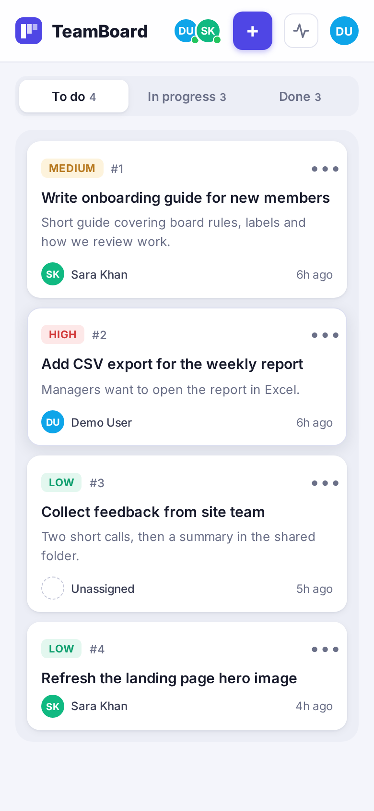
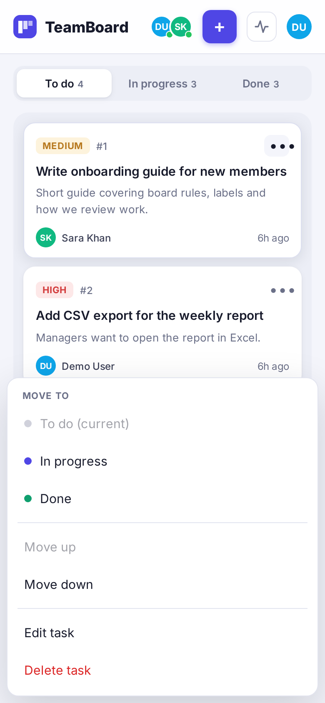
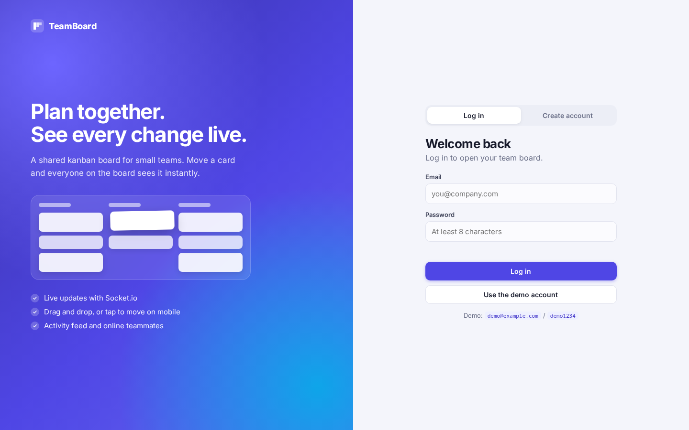

# Task Tracker Realtime

A shared team kanban board where every change shows up instantly in every open browser tab, built with Node.js, Express, Socket.io and SQLite.



| Board (desktop) | Mobile | Move menu (touch) |
| --- | --- | --- |
|  |  |  |



## Features

- **Accounts:** register and log in. Passwords are hashed with bcrypt (bcryptjs), sessions use a JWT sent in the `Authorization: Bearer` header.
- **One shared team board** with three columns: To do, In progress and Done.
- **Tasks** with title, description, priority (low, medium, high), assignee, column, position, creator and timestamps.
- **Create, edit, move and delete** tasks. Move cards with HTML5 drag and drop, or with the card menu (move to a column, move up, move down) which works on touch screens.
- **Live updates over Socket.io.** Every create, edit, move and delete is broadcast, so other open tabs update straight away and the changed card is highlighted.
- **Socket authentication:** the JWT is checked in the Socket.io handshake, unauthenticated sockets are refused.
- **Who is online:** avatars and a count of teammates currently on the board.
- **Activity feed** of recent changes, updated live.
- **Validation** with zod (clear field errors with a 400), a central error handler and JSON 404s.
- **Responsive UI** in plain HTML, CSS and JavaScript (no framework, no build step). On phones the columns become tabs.
- **Tests** for auth, the tasks API and the realtime events.

## Tech stack

| Part | Choice |
| --- | --- |
| Runtime | Node.js 18+ |
| Web server | Express 4 |
| Realtime | Socket.io 4 |
| Database | SQLite with better-sqlite3 |
| Auth | bcryptjs, jsonwebtoken |
| Validation | zod |
| Frontend | HTML, CSS, vanilla JavaScript |
| Tests | Jest, supertest, socket.io-client |

## Getting started

```bash
git clone https://github.com/mohammadgulab/task-tracker-realtime.git
cd task-tracker-realtime
npm install
cp .env.example .env
npm run seed
npm start
```

Open http://localhost:3000 and log in with the demo account:

| Email | Password |
| --- | --- |
| demo@example.com | demo1234 |
| sara@example.com | sara1234 |

To see the live updates, log in as the demo user in one window and as Sara in another (or a private window), then move a card.

Other scripts:

```bash
npm run dev   # restarts on file changes (node --watch)
npm test      # runs the test suite
```

## Environment variables

| Variable | Default | Description |
| --- | --- | --- |
| `PORT` | `3000` | Port the server listens on |
| `DB_PATH` | `./data/app.db` | SQLite database file, created on first run |
| `JWT_SECRET` | dev value | Secret used to sign tokens. Required when `NODE_ENV=production` |
| `JWT_EXPIRES_IN` | `7d` | How long a login token stays valid |
| `ACTIVITY_LIMIT` | `30` | Default number of activity items returned |

## API endpoints

All `/api/tasks`, `/api/activity` and `/api/users` routes need `Authorization: Bearer <token>`.

| Method | Path | Description |
| --- | --- | --- |
| POST | `/api/auth/register` | Create an account. Body: `name`, `email`, `password` (8+ chars). Returns `token` and `user` |
| POST | `/api/auth/login` | Log in. Body: `email`, `password`. Returns `token` and `user` |
| GET | `/api/auth/me` | The logged in user |
| GET | `/api/tasks` | All tasks, ordered by column and position |
| GET | `/api/tasks/:id` | One task |
| POST | `/api/tasks` | Create a task. Body: `title`, optional `description`, `priority`, `status`, `assignee_id` |
| PATCH | `/api/tasks/:id` | Edit or move a task. Any of `title`, `description`, `priority`, `assignee_id`, `status`, `position` |
| DELETE | `/api/tasks/:id` | Delete a task |
| GET | `/api/activity` | Recent changes, newest first. Optional `?limit=1..100` |
| GET | `/api/users` | Team members, for the assignee picker |
| GET | `/api/health` | Health check |

Column values for `status` are `todo`, `in_progress` and `done`. When `status` or `position` changes, the server renumbers the affected columns so positions always stay in order.

Example:

```bash
curl -X PATCH http://localhost:3000/api/tasks/5 \
  -H "Authorization: Bearer $TOKEN" \
  -H "Content-Type: application/json" \
  -d '{"status":"done","position":0}'
```

## Socket events

Connect with the token in the handshake: `io({ auth: { token } })`. All events are sent from the server to every connected client.

| Event | Payload | When |
| --- | --- | --- |
| `presence:update` | `{ users: [{ id, name }] }` | Someone opens or closes the board |
| `task:created` | `{ task, by }` | A task is created |
| `task:updated` | `{ task, by }` | Title, description, priority or assignee changed |
| `task:moved` | `{ task, positions: [{ id, status, position }], by }` | A task changed column or order |
| `task:deleted` | `{ id, by }` | A task is deleted |
| `activity:new` | `{ id, user_name, message, created_at, ... }` | Any change is logged to the feed |

A connection with a missing or invalid token is refused with the error `unauthorized`.

## Project structure

```
task-tracker-realtime/
├── public/
│   ├── index.html        login screen and board
│   ├── style.css         layout, cards, responsive styles
│   └── app.js            board logic, drag and drop, socket client
├── src/
│   ├── routes/
│   │   ├── auth.js       register, login, me
│   │   ├── tasks.js      task CRUD and moves
│   │   ├── activity.js   activity feed
│   │   └── users.js      team members
│   ├── app.js            Express app setup
│   ├── server.js         HTTP server and Socket.io start up
│   ├── socket.js         socket auth, presence, broadcasts
│   ├── db.js             SQLite connection and schema
│   ├── tasks.js          task queries and position logic
│   ├── activity.js       activity log queries
│   ├── auth.js           JWT helpers and auth middleware
│   ├── validation.js     zod schemas
│   ├── errors.js         error handler and 404
│   ├── config.js         environment settings
│   └── seed.js           demo users and tasks
├── tests/
│   ├── helpers.js
│   ├── auth.test.js
│   ├── tasks.test.js
│   └── socket.test.js
├── docs/screenshots/
├── .env.example
├── LICENSE
└── package.json
```

## Tests

```bash
npm test
```

The suite uses an in-memory SQLite database, so it never touches your data. It covers:

- **Auth:** register, duplicate email (409), validation errors, good and bad login, `GET /me` with and without a token, bad JSON, unknown routes.
- **Tasks:** 401 without a token on every route, create with defaults, validation, unknown assignee, edit, moving between columns with renumbering, reordering inside a column, clamping positions, 404s, delete, and the activity feed.
- **Realtime:** a socket with a bad token is refused, a task created over REST is broadcast to a connected socket.io-client, moves, deletes and activity are broadcast, and presence updates when users join and leave.

## License

MIT, see [LICENSE](LICENSE). Copyright (c) 2026 Mohammad Gulab.
